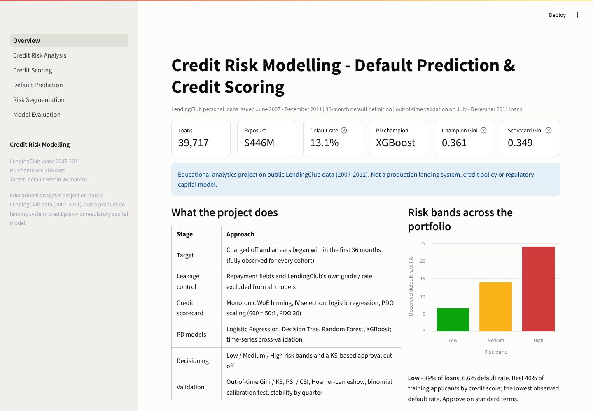
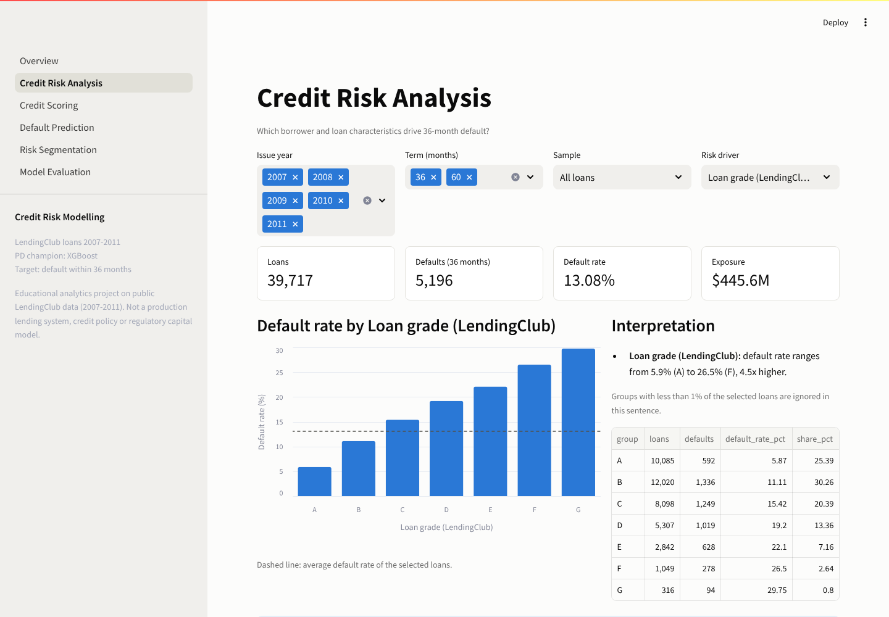
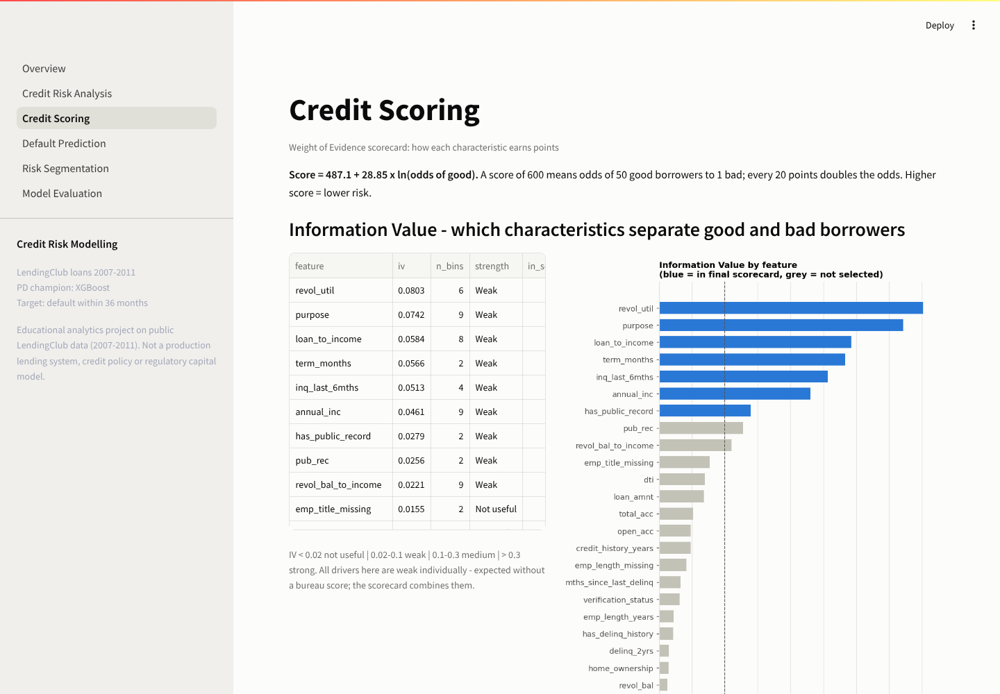
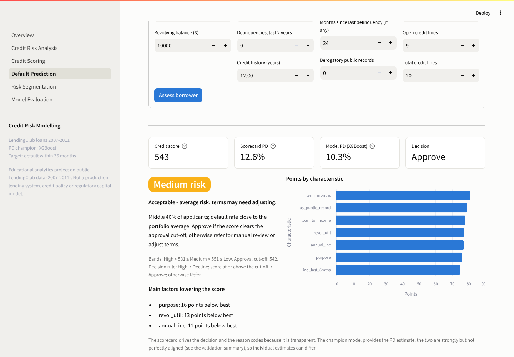
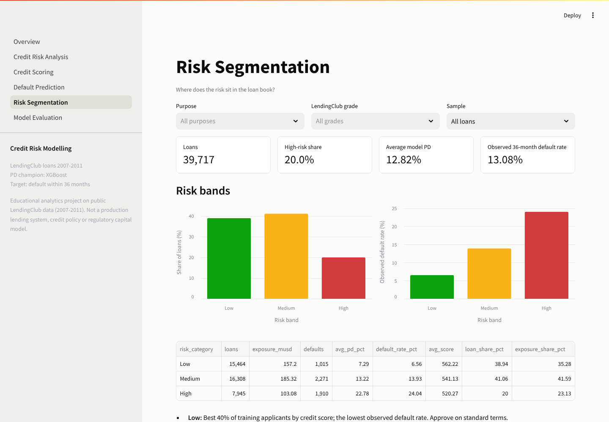
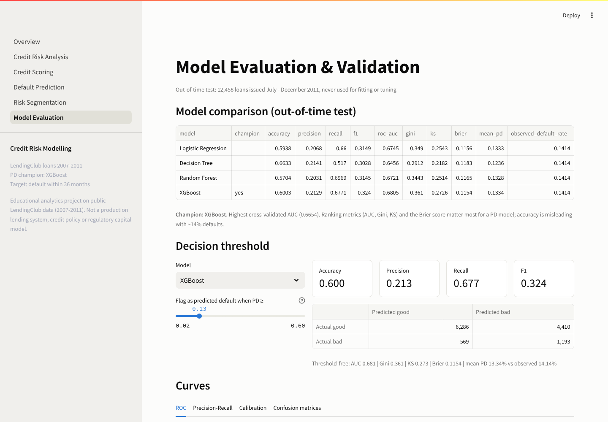

# Credit Risk Modelling – Borrower Default Prediction & Credit Scoring

  

An end-to-end retail credit risk project on 39,717 LendingClub personal loans issued between 2007 and 2011:

- a **Weight-of-Evidence logistic-regression credit scorecard**;
- **Probability of Default (PD)** models, compared head to head;
- **risk segmentation and approval cut-off analysis**;
- **out-of-time model validation** (discrimination, stability and calibration);
- a six-page **Streamlit dashboard**.

> **Disclaimer.** This is an educational analytics project built on public historical data. It is **not** a production lending system, a credit policy, or a regulatory capital (Basel) or impairment (IFRS 9) model, and it has not been independently validated. Results describe one lender's 2007–2011 loans and should not be used to make real credit decisions.

---

## Contents
1. [Project overview](#1-project-overview)
2. [Business problem](#2-business-problem)
3. [Project objectives](#3-project-objectives)
4. [Dataset description and source](#4-dataset-description-and-source)
5. [Project architecture](#5-project-architecture)
6. [End-to-end workflow](#6-end-to-end-workflow)
7. [Credit risk methodology](#7-credit-risk-methodology)
8. [WoE and IV](#8-weight-of-evidence-and-information-value)
9. [Credit scorecard development](#9-credit-scorecard-development)
10. [Probability of Default modelling](#10-probability-of-default-modelling)
11. [Machine learning models](#11-machine-learning-models)
12. [Model evaluation](#12-model-evaluation)
13. [Model validation](#13-model-validation)
14. [Key findings](#14-key-findings)
15. [Dashboard screenshots](#15-dashboard-screenshots)
16. [Installation](#16-installation)
17. [Execution](#17-execution)
18. [Limitations](#18-project-limitations)
19. [Future improvements](#19-future-improvements)

---

## 1. Project overview

| | |
|---|---|
| Data | LendingClub personal loans, issued Jun 2007 – Dec 2011, 39,717 loans, $445.6M |
| Target | Default within 36 months of origination (13.1% of loans) |
| Scorecard | 7 characteristics; score range 449–595; 600 = 50:1 odds; PDO 20 |
| PD models | Logistic Regression (WoE), Decision Tree, Random Forest, XGBoost |
| Validation | Out-of-time test on 12,458 loans issued Jul–Dec 2011 |
| Champion PD model | XGBoost: test Gini 0.361 (scorecard 0.349; LendingClub sub-grade 0.311) |
| Code | Modular Python package, 10 scripted phases, 68 pytest tests, Streamlit app |

## 2. Business problem
A consumer lender has to decide **at the point of application** whether to lend and on what terms, using only the application and the credit bureau report. Approving a borrower who later defaults loses most of the unsecured principal. Rejecting a borrower who would have repaid loses the interest margin.

The lender needs a transparent, explainable risk ranking (a scorecard), a calibrated PD for pricing and expected loss, risk bands with an approval cut-off, and evidence that the model still works on *new* borrowers. More detail: [docs/01_business_problem.md](docs/01_business_problem.md).

## 3. Project objectives
1. Identify the origination-time drivers of default.
2. Build a statistical credit scoring system (WoE / IV / logistic regression / PDO scaling).
3. Estimate the Probability of Default.
4. Compare the statistical scorecard with machine-learning models.
5. Classify borrowers into Low / Medium / High risk and analyse approval cut-offs.
6. Validate discrimination, stability and calibration out-of-time.
7. Deliver an interactive dashboard for credit officers and risk managers.

## 4. Dataset description and source

| Item | Value |
|---|---|
| File | `loan.csv`, LendingClub loans issued 2007–2011 (39,717 rows × 111 columns) |
| Loan status | Fully Paid 32,950 · Charged Off 5,627 · Current 1,140 |
| Snapshot | Not stated in the file; inferred as **May 2016** (latest payment / credit-pull month) |
| Usable columns | 54 columns are entirely empty and 9 are constant; 24 origination-time model features are derived |

**How to obtain the data.** The raw file is **not** included in this repository. Search Kaggle for **"Lending Club Loan Dataset 2007-2011"**: the `loan.csv` used in the widely published *Lending Club case study*. LendingClub originally released this data as its public 2007–2011 loan statistics. Save it as `data/raw/loan.csv`. Phase 1 checks the required columns and warns if the shape is not 39,717 × 111. See [data/raw/README.md](data/raw/README.md).

Full data dictionary (all 111 columns, their meaning, when each value is known, and its treatment): `reports/phase1/data_dictionary.csv`, produced by Phase 1. Dataset documentation: [docs/02_dataset_documentation.md](docs/02_dataset_documentation.md).

## 5. Project architecture

```
credit-risk-modelling/
├── run_all.py                  # runs Phases 1-10 in order
├── src/                        # reusable, tested code
│   ├── config.py               # paths, target, split date, features, scaling, validation rules
│   ├── data/                   # Phase 1: loading + file validation, data dictionary, quality checks
│   ├── preprocessing.py        # Phase 2: cleaning, target construction, leakage guard, split, caps
│   ├── eda.py                  # Phase 3
│   ├── woe.py, scorecard.py    # Phase 4: WoE/IV binning, feature selection, logit, PDO scaling
│   ├── risk_bands.py           # Phase 5
│   ├── models.py, metrics.py   # Phases 6-7: PD models, time-series CV, calibration, metrics
│   ├── assessment.py           # Phase 8: input validation, borrower scoring, reason codes
│   ├── portfolio.py            # Phase 9
│   ├── validation.py           # Phase 10: PSI/CSI, Hosmer-Lemeshow, binomial test
│   └── plots.py, utils.py
├── scripts/run_phase1.py ... run_phase10.py
├── app/                        # Streamlit dashboard (Overview.py + pages/)
├── tests/                      # pytest suite
├── docs/                       # business, data, methodology, development, evaluation, limitations
├── notebooks/                  # Phase 1 walkthrough (committed without outputs)
├── reports/                    # generated: phase reports (.md), tables (.csv), figures (.png)
├── assets/images/              # dashboard screenshots
├── data/                       # raw / interim / processed (git-ignored)
└── models/                     # trained artefacts (git-ignored, regenerated)
```

## 6. End-to-end workflow

| Phase | Script | Output |
|---|---|---|
| 1 Data understanding | `run_phase1` | File validation, data dictionary, data quality report |
| 2 Preprocessing | `run_phase2` | Clean data, 36-month target, chronological split, outlier caps |
| 3 EDA | `run_phase3` | Default-rate drivers, correlations, vintage curves |
| 4 Scorecard | `run_phase4` | WoE bins, IV, selected characteristics, coefficients, points |
| 5 Risk classification | `run_phase5` | Risk bands, approval cut-off trade-off |
| 6 PD models | `run_phase6` | 4 tuned models, cross-validation results, calibration decisions |
| 7 Evaluation | `run_phase7` | Test metrics, ROC / PR / calibration curves, champion choice |
| 8 Borrower assessment | `run_phase8` | Score, PD, band, decision and reason codes |
| 9 Portfolio analysis | `run_phase9` | Risk mix, exposure, high-risk concentration |
| 10 Validation | `run_phase10` | Out-of-time, PSI/CSI, calibration tests, stability, sensitivity |

## 7. Credit risk methodology

**Target: default within 36 months.** A loan is *bad* if it was charged off **and** the delinquency that led to charge-off began within its first 36 months on book. All other loans are *good*. LendingClub provides no payment history, so the month arrears began is estimated as the **earliest** of:

- the first instalment not covered by principal repaid (from the annuity amortisation schedule);
- the month after the last payment received;
- the contractual term.

Every loan has at least 53 months of history, so the 36-month outcome is fully observed for every cohort. The 1,140 `Current` loans (all 60-month, repaying for 53+ months) are correctly good. The original *Charged Off vs Fully Paid, Current excluded* definition is kept as a sensitivity check. Why this matters, and how it differs from using the last payment date alone: [docs/03_methodology.md](docs/03_methodology.md#2-target-definition).

**Leakage control.** The 14 repayment fields (`total_pymnt`, `recoveries`, `last_pymnt_d`, …) are used only to build the label, then dropped. LendingClub's `grade`, `sub_grade`, `int_rate` and `installment` are LendingClub's own risk output, so they are excluded from all models and used only as a benchmark. `check_no_leakage()` enforces this in code and in the tests.

**Out-of-time design.** Train on loans issued Jun 2007 – Jun 2011 (27,259; 12.6% default). Test on Jul – Dec 2011 (12,458; 14.1% default). Every fitted quantity is learned on the training sample only: WoE bins, outlier caps, feature selection, hyperparameters, calibration, band cut-offs and the decision threshold.

## 8. Weight of Evidence and Information Value

$$WoE_i = \ln\frac{\%\text{Good}_i}{\%\text{Bad}_i}, \qquad IV = \sum_i (\%\text{Good}_i - \%\text{Bad}_i)\,WoE_i$$

- **Numeric characteristics:** start from 20 quantile bins, then merge neighbours until the bad rate is **monotonic** and every bin holds **at least 5%** of loans.
- **Missing values:** a missing-value bin under 5% is pooled with the bin that has the closest bad rate.
- **Categories:** categories under 2% are pooled into "RARE".
- **Unseen values:** values never seen in training are scored as the **riskiest** bin, a conservative choice.

Counts are smoothed by 0.5 and re-normalised. The strongest characteristics are revolving utilisation (IV 0.080), purpose (0.074), loan-to-income (0.058), term (0.057), inquiries (0.051) and income (0.046). **All are individually weak (IV < 0.1).** This is expected without a bureau score.

## 9. Credit scorecard development
1. Keep characteristics with IV ≥ 0.02 (and below 0.5, where leakage becomes a concern).
2. Remove characteristics whose WoE correlates above 0.6 with a stronger one (`pub_rec` was removed in favour of `has_public_record`).
3. Fit a logistic regression on the WoE values, then remove, one at a time, any characteristic with a wrong (positive) sign or p > 0.05 (`revol_bal_to_income`, p = 0.053).
4. **Scaling (Points to Double the Odds):** Factor = 20 / ln 2 = 28.85; Offset = 600 − Factor × ln 50 = 487.12.
   - Score = Offset − Factor × logit(PD).
   - Points for bin *j* of characteristic *k* = −(β<sub>k</sub>·WoE<sub>kj</sub> + β<sub>0</sub>/n)·Factor + Offset/n.

Final scorecard: **7 characteristics**, all coefficients negative, all p < 0.001, all VIF < 1.2. Score range 449–595.

| Characteristic | Best bin (points) | Worst bin (points) |
|---|---|---|
| Purpose | car (92) | small business (55) |
| Revolving utilisation | ≤ 23.8% (90) | > 87.4% or missing (64) |
| Annual income | > $100k (88) | ≤ $23.9k (65) |
| Inquiries, 6 months | 0 (84) | 3+ (63) |
| Term | 36 months (81) | 60 months (67) |
| Loan-to-income | ≤ 5.7% (81) | > 30% (71) |
| Public record | none (79) | any (64) |

**Risk bands** are taken from training-score percentiles: High < 531 ≤ Medium < 551 ≤ Low (worst 20% / middle 40% / best 40%). The **KS-optimal approval cut-off** is chosen on train: score 542.

## 10. Probability of Default modelling
- **Champion selection rule, fixed in `config.py` before testing:** highest cross-validated AUC, unless the interpretable logistic regression is within 0.01 AUC.
- **Result:** XGBoost CV AUC 0.665 vs logistic regression 0.651. The gap is 0.015, so **XGBoost is the PD champion**.
- **Roles:** the scorecard remains the decision tool, because it gives transparent points and reason codes. XGBoost supplies the PD estimate. The two PDs have a rank correlation of 0.90.
- **Class imbalance:** no re-weighting, because it would distort probabilities. Imbalance is handled through the decision threshold, which is the training default rate (12.6%).
- **Calibration:** Platt scaling is applied only if it improves the Brier score by ≥ 1% in a cross-fitted out-of-fold comparison. Only the Decision Tree qualified.

## 11. Machine learning models

| Model | Tuning (time-series 4-fold CV, ROC-AUC) | Selected | CV AUC |
|---|---|---|---|
| Logistic Regression (WoE) | C ∈ {0.01, 0.1, 1, 10}; **WoE binning and feature selection re-run inside every fold** | C = 1 | 0.651 ± 0.027 |
| Decision Tree | depth × min leaf (20 configurations) | depth 6, leaf 50 | 0.611 ± 0.017 |
| Random Forest | 12 random configurations | 200 trees, depth 10, leaf 20 | 0.659 ± 0.026 |
| XGBoost | 15 random configurations | 600 trees, lr 0.02, depth 3, min child 10 | 0.665 ± 0.022 |

Time-series CV trains each fold on older loans and validates on the next block of newer loans, the same direction as the real out-of-time test.

## 12. Model evaluation (out-of-time test, threshold PD ≥ 12.6%)

| Model | Accuracy | Precision | Recall | F1 | ROC-AUC | Gini | KS | Brier |
|---|---|---|---|---|---|---|---|---|
| Logistic Regression | 0.594 | 0.207 | 0.660 | 0.315 | 0.675 | 0.349 | 0.254 | 0.116 |
| Decision Tree | 0.663 | 0.214 | 0.517 | 0.303 | 0.646 | 0.291 | 0.218 | 0.118 |
| Random Forest | 0.570 | 0.203 | 0.697 | 0.315 | 0.672 | 0.344 | 0.251 | 0.117 |
| **XGBoost (champion)** | 0.600 | 0.213 | 0.677 | 0.324 | **0.681** | **0.361** | **0.273** | **0.115** |
| *LendingClub sub-grade (benchmark)* | – | – | – | – | 0.656 | 0.311 | 0.231 | – |

Accuracy is misleading here: with a 14% default rate, flagging nobody would score 86%. The ranking metrics and Brier score are what matter for a PD model. Details: [docs/05_model_evaluation_report.md](docs/05_model_evaluation_report.md).

## 13. Model validation (champion: XGBoost)

| Check | Result | Status |
|---|---|---|
| Out-of-time discrimination | AUC 0.681, Gini 0.361 | Pass |
| Overfitting (train − test AUC) | +0.042 (Random Forest +0.122 overfits) | Pass |
| CV stability (AUC std) | 0.022 | Pass |
| Score PSI (train → test) | 0.014 | Pass |
| Maximum characteristic CSI | 0.044 (term) | Pass |
| Calibration-in-the-large (binomial test) | mean PD 13.34% vs observed 14.14%, z = 2.71, p = 0.007 | **Monitor** |
| Hosmer-Lemeshow (10 groups, 10 d.f., out-of-sample) | HL = 27.4, p = 0.002 | **Monitor** |
| Scorecard PD vs champion PD (Spearman) | 0.90 | Pass |

**Calibration finding.** The test period was riskier than the training period (14.1% vs 12.6% default rate), and the model **under-predicts PD by about 0.8 percentage points**. Ranking is unaffected. In production this would be addressed by recalibrating the PD level to recent experience, and it is reported here rather than hidden.

## 14. Key findings
- **Drivers of default:** small-business purpose (24% default rate vs 7.8% for car loans), high revolving utilisation (17% above 80% vs 9% below 20%), recent credit inquiries, low income, 60-month term and high loan-to-income.
- **The scorecard ranks risk better than LendingClub's own sub-grade** (test Gini 0.349 vs 0.311) without using any LendingClub pricing information or a FICO score.
- **XGBoost adds 1.2 Gini points over the scorecard.** That is a real but modest gain, against a loss of transparency.
- **Risk bands separate well out-of-time:** Low 6.8%, Medium 14.2%, High 25.8% default rate.
- **Cut-off trade-off (test):** declining the High band (score < 531) rejects 22% of applicants and removes 41% of defaulters, lowering the approved bad rate from 14.1% to 10.8%. The KS cut-off (542) would reject 44% of applicants.
- **Target definition matters:** using the last payment date alone dates default about 2 months too late for typical defaulters. The arrears-based estimate reclassifies 47 loans as defaults.

## 15. Dashboard screenshots
Captured from the running Streamlit app (`streamlit run app/Overview.py`) after a full pipeline run.

| Overview | Credit Risk Analysis |
|---|---|
|  |  |
| **Credit Scoring** | **Default Prediction** |
|  |  |
| **Risk Segmentation** | **Model Evaluation** |
|  |  |

## 16. Installation
Requires **Python 3.12** (see `.python-version`).

```bash
git clone https://github.com/<your-username>/credit-risk-modelling.git
cd credit-risk-modelling

# Windows
py -3.12 -m venv .venv
.venv\Scripts\activate
# macOS / Linux
python3.12 -m venv .venv
source .venv/bin/activate

pip install -r requirements.txt
```

Then place `loan.csv` in `data/raw/` (see section 4).

## 17. Execution

```bash
python run_all.py                 # Phases 1-10, about 4-6 minutes; writes data/processed, models, reports
pytest                            # 68 tests: synthetic-data tests always run; real-data tests need run_all first
streamlit run app/Overview.py     # dashboard at http://localhost:8501
```

- Run a single phase with `python -m scripts.run_phase4`, or restart part-way with `python run_all.py --from 6`.
- In VS Code, `.vscode/launch.json` provides *Run full pipeline* and *Streamlit app* configurations (F5).
- All randomness is seeded (`RANDOM_SEED = 42`). With the pinned versions, re-running reproduces the numbers above.

## 18. Project limitations
- **No FICO / bureau score** in this extract, so characteristics are individually weak and the Gini is around 0.35.
- **Approved loans only.** There is no reject inference, so there is through-the-door selection bias.
- **Default timing is estimated from cumulative totals.** The month arrears began is an upper-bound estimate, not an observed date.
- **36-month PD**, not the 12-month PD used in Basel IRB or the lifetime PD used in IFRS 9.
- **One lender and one period (2007–2011)**, with no macroeconomic variables, so no through-the-cycle or stressed PD.
- **The champion under-predicts in the test period** (calibration flagged). XGBoost is less transparent than the scorecard.
- **No LGD, EAD or expected-loss model.**

Full list and assumptions: [docs/06_limitations_and_assumptions.md](docs/06_limitations_and_assumptions.md).

## 19. Future improvements
These are **not implemented**, and nothing in this project claims Basel III or IFRS 9 compliance:
- **LGD** from post-charge-off recoveries, and **EAD** / credit-conversion analysis (the outstanding balance at default for amortising loans).
- **Expected loss** (PD × LGD × EAD) and an IFRS 9-style **ECL** with Stage 1/2/3 classification and lifetime PD. This would need payment-history data to define significant increase in credit risk.
- **Basel-style capital:** IRB risk-weight function, RWA and capital ratio, using a 12-month PD and a downturn LGD.
- **Stress testing** with macroeconomic scenarios (unemployment, rates) linked to PD through a satellite model.
- **PD recalibration** to recent default rates and ongoing PSI / calibration monitoring.
- **Explainability** for the champion (for example SHAP), plus fairness and adverse-impact testing.
- A newer LendingClub extract with FICO ranges and payment history.

---

**Documentation:** [Business problem](docs/01_business_problem.md) · [Dataset](docs/02_dataset_documentation.md) · [Methodology](docs/03_methodology.md) · [Model development](docs/04_model_development_report.md) · [Model evaluation](docs/05_model_evaluation_report.md) · [Limitations](docs/06_limitations_and_assumptions.md) · [Changelog](CHANGELOG.md)

Licence: MIT (see [LICENSE](LICENSE)). The dataset is not redistributed; check the terms of the source you download it from.
